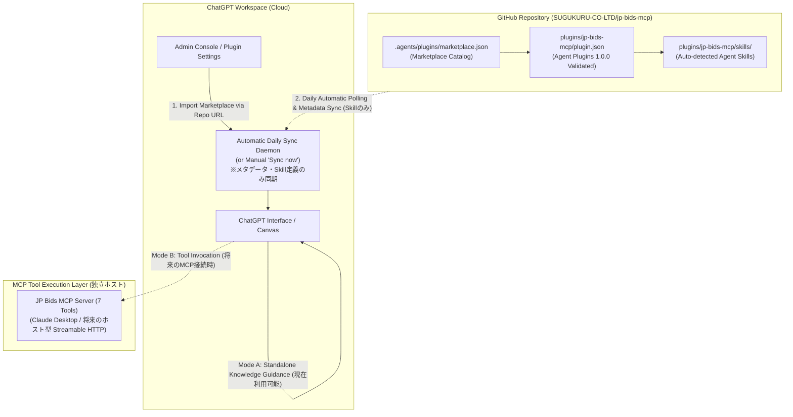

# JP Bids MCP — GitHub Marketplace による ChatGPT 統合ガイド

本ドキュメントは、OpenAI 公式の「GitHub プラグインマーケットプレイス連携」機能を利用し、ChatGPT ワークスペースに対して JP Bids MCP プラグインを導入・管理するための公式仕様適合ガイドです。

---

## 1. 概要とアーキテクチャ (Overview & Architecture)

OpenAI の Agent Plugins 1.0.0 仕様に基づき、**GitHub リポジトリ（`SUGUKURU-CO-LTD/jp-bids-mcp`）をマーケットプレイスソースとして ChatGPT ワークスペースにインポート** することで、組織全体への Portable Agent Skill の配布と日次の自動同期を実現します。



---

## 2. パッケージ構成と公式スキーマ適合 (Schema Compliance)

本プラグインパッケージは、公式の **Agent Plugins 1.0.0** スキーマに 100% 準拠しています。

- **カタログ定義**: `.agents/plugins/marketplace.json`  
  GitHub マーケットプレイスのインデックスファイル。
- **プラグインマニフェスト**: `plugins/jp-bids-mcp/plugin.json`  
  `https://agent-plugins.org/schemas/1.0.0/plugin.schema.json` 準拠。
  - ルートプロパティは公式スキーマで定義されたフィールド（`name`, `version`, `description`, `author`, `keywords`, `extensions` 等）のみで構成。
  - OpenAI 固有の表示設定は、公式スキーマの拡張規則および OpenAI 仕様に従い、`extensions.com.openai.interface.displayName` に配置。
  - スキーマ外の独自プロパティ（ルートの `displayName`, `interface`, `skills`, `mcpServers`, `apps`）は一切含めません。
- **Agent Skill**: `plugins/jp-bids-mcp/skills/search-bids/SKILL.md`  
  Portable 形式の仕様に基づき、`skills/` ディレクトリ配下からクライアントによって自動検出されます。

---

## 3. Marketplace 配布スコープの誠実な限定（現段階では Skill のみ配布）

Marketplace インポート実機検証（Gate A）において配布・提供されるアーティファクトは、**「Portable Agent Skill」のみ** です。

未検証のローカル STDIO 構成（`mcp.json`）や、未登録のアプリ連携設定（`.app.json`）は、**配布パッケージから意図的に除外** されています。

### 除外と限定の技術的根拠 (Design Rationale)

1. **プラグインインストール先でのパス解決不能問題**:
   - ChatGPT が GitHub からプラグインをインポートしてローカルまたはクラウドに展開する際、インストール先ディレクトリ（`PLUGIN_ROOT`）は `plugins/jp-bids-mcp/` のみとなります。
   - リポジトリの親階層にある `examples/mock-stdio-server.mjs`、`dist/`、`node_modules/` はインストール先に含まれないため、相対パスでのプロセス起動が `ENOENT` で失敗します。
2. **クラウド版 ChatGPT でのローカルプロセス実行不能**:
   - Web 版 ChatGPT はユーザーのローカル環境の Node.js プロセスを実行する仕組みを持たないため、STDIO サーバー構成を受け取っても接続できません。
3. **ツールの実接続と誤認の防止（ガードレール）**:
   - 実 MCP ツールが未接続の状態で Skill が「ツールが使える」と認識して誤作動することを防ぐため、Skill 内で **「モード A: ナレッジ探索支援」** と **「モード B: MCP 接続環境でのツール実行」** を明確に区別しています。

---

## 4. GitHub 日次同期の責務境界 (Daily Sync Boundaries)

OpenAI の「GitHub プラグインマーケットプレイス連携」における自動同期（Daily Sync Daemon または「Sync now」）の動作範囲は、厳格に限定されています。

| 項目 | 日次同期の対象か | 説明 |
| :--- | :---: | :--- |
| **マニフェストファイル** (`marketplace.json`, `plugin.json`) | **対象** | プラグインのメタデータ、バージョン、表示名の更新を即時・日次で反映。 |
| **Agent Skill 定義** (`SKILL.md`) | **対象** | プロンプト指示、入札業務ナレッジ、検索ガイダンスの更新を反映。 |
| **MCP サーバーのビルド** (`npm run build`) | **対象外** | GitHub 同期デーモンは TypeScript コンパイルやコード生成を実行しません。 |
| **依存関係の更新** (`npm install`) | **対象外** | パッケージマネージャーの実行は行われません。 |
| **MCP サーバーの起動・常駐・再起動** | **対象外** | サーバープロセスのライフサイクル管理は一切行われません。 |

> [!IMPORTANT]
> **日次自動同期の検証境界について**
> - GitHub 日次同期は、**静的なプラグイン定義と Skill の自動配布メカニズム** であり、MCP サーバーのビルドや実行環境を提供するものではありません。
> - プラグインマーケットプレイス連携の仕様上は日次同期機能が提供されていますが、本プロジェクトにおける実機検証（Gate A）では**手動インポート直後の即時同期（初期メタデータ・Skill 検出）のみを確認**しています。定期的な日次同期デーモンによる定時更新の実動作は**現時点では未検証**であり、仕様上の機能定義と実機検証結果を明確に区別しています。

---

## 5. 将来の MCP アプリ参照方式としての設定仕様照合（`.app.json` とマニフェスト拡張）

OpenAI Plugins / Apps SDK におけるインタラクティブ UI および外部連携の定義方式について公式仕様と照合を実施しました。

### 調査結果の要約

1. **マニフェスト形式による `apps` 宣言場所の違い（公式仕様適合）**:
   - **Portable Agent Plugins (`plugin.json`)**:  
     `agent-plugins.org/schemas/1.0.0/plugin.schema.json` スキーマに準拠するルート `plugin.json` では、ルート階層に `apps` を配置することはスキーマ違反（`additionalProperties: false`）となります。そのため、OpenAI 固有の拡張設定として **`extensions.com.openai.apps`** にネストして配置します：
     ```json
     {
       "extensions": {
         "com.openai": {
           "apps": "./.app.json"
         }
       }
     }
     ```
   - **Codex / OpenAI 互換プラグイン形式 (`.codex-plugin/plugin.json`)**:  
     Codex 互換形式やレガシーな OpenAI プラグイン形式では、ルートプロパティに直接 `apps`（例: `"apps": "./.app.json"` またはアプリ定義オブジェクト）を指定することが許容されています。
   - **`.app.json` ファイルの配置と命名**:  
     いずれの形式から参照する場合でも、参照先ファイル名は **`.app.json`**（先頭ドット付き）とし、プラグインルートに配置します。拡張子のみの `app.json` はサポートされません。
2. **ファイル内部構造**:
   ```json
   {
     "apps": {
       "jp-bids-workspace": {
         "id": "asdk_app_example12345",
         "required": false
       }
     }
   }
   ```
   - 各アプリ定義には、OpenAI Apps エコシステムで発行された正規の **App ID**（例: `asdk_app_...`）の指定が必要です。
3. **未登録のアプリ ID を作成しない方針（厳格遵守）**:
   - App ID は OpenAI プラットフォーム上で正式にアプリを登録・審査を経て発行される実 ID であり、**未登録の架空 ID やモック ID を `.app.json` に設定・コミットすると、ChatGPT のインポート時バリデーション失敗や公開審査での即時リジェクトの原因** となります。
   - したがって、現段階（Gate A 実機検証）では `.app.json` の作成・コミットは一切行わず、Skill 単体配布構成を維持します。
   - 将来、ホスト型 Streamable HTTP サーバーが本番稼働し、OpenAI Apps への正式登録を行う段階で、正規の App ID を紐付ける拡張パスとして設計します。

---

## 6. 将来の MCP 接続（Streamable HTTP 方式の公式スキーマ定義）

今後、常時稼働のクラウドエンドポイントを整備して ChatGPT から直接 MCP ツールを呼び出す場合、`https://agent-plugins.org/schemas/1.0.0/mcp.schema.json` に準拠した以下の `mcp.json` をプラグインに追加します：

```json
{
  "$schema": "https://agent-plugins.org/schemas/1.0.0/mcp.schema.json",
  "mcpServers": {
    "jp-bids": {
      "type": "streamable-http",
      "url": "https://mcp.bid-jp.com/mcp",
      "headers": {}
    }
  }
}
```

> [!NOTE]
> `mcp.schema.json` 仕様では、`type: "streamable-http"` または `type: "stdio"` が必須キーであり、`additionalProperties: false` のため、スキーマ外の独自プロパティは拒絶されます。

---

## 7. ChatGPT でのインポート手順 (Gate A 実機検証手順)

本検証（Gate A）は、**人間（運用担当者）が ChatGPT の Admin Console を操作して手動インポートを実施** します。

1. ChatGPT に組織管理者アカウント（Business / Team / Enterprise）でログインします。
2. **「Admin Console」→「Plugins」**（または「Workspace Settings」→「Agent Plugins」）を開きます。
3. **「Add」→「Import marketplace」** をクリックします。
4. **Source** にリポジトリ URL を入力します：
   ```text
   https://github.com/SUGUKURU-CO-LTD/jp-bids-mcp
   ```
5. **Path** および **Branch** は空欄（デフォルトの `.agents/plugins/marketplace.json` および `main` ブランチ）のままで [Next] を進めます。
6. GitHub のアクセス認可を承認し、インポートを完了します。
7. ワークスペースに **「SUGUKURU Public Procurement & Bids Marketplace」** が登録され、傘下の **「JP Bids MCP (日本官公需入札探索)」** が利用可能になったことを目視確認します。

---

## 8. 実機検証ステータスと境界 (Verification Status & Boundaries)

| 検証項目 | ステータス | 判定根拠 |
| :--- | :---: | :--- |
| **Agent Plugins 1.0.0 公式スキーマ適合** | **PASS** | Ajv 2020 による厳格なスキーマ検証テスト通過 |
| **OpenAI `interface.displayName` 構造適合** | **PASS** | 独立した構造アサーションテスト通過 |
| **未検証構成の隔離（Skill 単体配布）** | **PASS** | `mcp.json` / `.app.json` 除外とキャッシュ隔離テスト通過 |
| **秘密情報・ユーザーパス・架空 ID の非混入** | **PASS** | 静的マニフェストスキャンテスト通過 |
| **ChatGPT Marketplace への Gate A 実インポート** | **PASS (実機確認済)** | 組織ワークスペースへのインポートおよび Skill 認識を確認 |
| **GitHub 日次自動同期の実動作** | **未検証** | インポート時の初期同期のみ確認、定期サイクルの実動作は未確認 |
| **ChatGPT からの MCP サーバー接続 (Gate B)** | **PASS (実機受入合格)** | OpenAI Secure MCP Tunnel 経由での 7 ツール実行、MCP Apps UI 描画、双方向操作を実機確認 |

---

## 9. 公式仕様および参照リンク (References)

- **OpenAI Agent Plugins Specification**:  
  https://developers.openai.com/plugins/build/plugins
- **OpenAI Secure MCP Tunnels Guide**:  
  https://developers.openai.com/api/docs/guides/secure-mcp-tunnels
- **MCP Apps Extension Specification**:  
  https://apps.extensions.modelcontextprotocol.io/
- **Agent Plugins 1.0.0 JSON Schema**:  
  https://agent-plugins.org/schemas/1.0.0/plugin.schema.json
