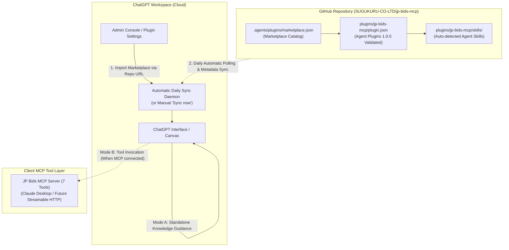

# JP Bids MCP — GitHub Marketplace による ChatGPT 統合ガイド

本ドキュメントは、OpenAI 公式の「GitHub プラグインマーケットプレイス連携」機能を利用し、ChatGPT ワークスペースに対して JP Bids MCP プラグインを導入・管理するための公式仕様適合ガイドです。

---

## 1. 概要とアーキテクチャ (Overview & Architecture)

OpenAI の Agent Plugins 1.0.0 仕様に基づき、**GitHub リポジトリ（`SUGUKURU-CO-LTD/jp-bids-mcp`）をマーケットプレイスソースとして ChatGPT ワークスペースにインポート** することで、組織全体への Portable Agent Skill の配布と日次の自動同期を実現します。



---

## 2. パッケージ構成と公式スキーマ適合 (Schema Compliance)

本プラグインパッケージは、公式の **Agent Plugins 1.0.0** スキーマに 100% 準拠しています。

- **カタログ定義**: `.agents/plugins/marketplace.json`  
  GitHub マーケットプレイスのインデックスファイル。
- **プラグインマニフェスト**: `plugins/jp-bids-mcp/plugin.json`  
  `https://agent-plugins.org/schemas/1.0.0/plugin.schema.json` 準拠。
  - ルートプロパティは公式スキーマで定義されたフィールド（`name`, `version`, `description`, `author`, `keywords`, `extensions` 等）のみで構成。
  - OpenAI 固有の表示設定は `extensions.com.openai` に配置。
  - スキーマ外の独自プロパティ（ルートの `displayName`, `skills`, `mcpServers`）は一切含めません。
- **Agent Skill**: `plugins/jp-bids-mcp/skills/search-bids/SKILL.md`  
  Portable 形式の仕様に基づき、`skills/` ディレクトリ配下からクライアントによって自動検出されます。

---

## 3. なぜ未検証のローカル STDIO 構成をプラグインから外したのか (Design Rationale)

当初検討された「プラグインパッケージ内に `mcp.json` を含めてローカル STDIO を起動する方式」については、以下の技術的制約が確認されたため、**Marketplace 配布パッケージから未検証の `mcp.json` を除外** し、自己完結する Agent Skill 配布に絞る判断を行いました。

1. **プラグインインストール先でのパス解決不能問題**:
   - ChatGPT が GitHub からプラグインをインポートしてローカルまたはクラウドに展開する際、インストール先ディレクトリ（`PLUGIN_ROOT`）は `plugins/jp-bids-mcp/` のみとなります。
   - リポジトリの親階層にある `examples/mock-stdio-server.mjs`、`dist/`、`node_modules/` はインストール先に含まれないため、相対パスでのプロセス起動が `ENOENT` で失敗します。
2. **クラウド版 ChatGPT での実行不能**:
   - Web 版 ChatGPT はユーザーのローカル環境の Node.js プロセスを実行する仕組みを持たないため、STDIO サーバー構成を受け取っても接続できません。
3. **ツールの実接続と誤認の防止**:
   - 実 MCP ツールが未接続の状態で Skill が「ツールが使える」と認識することを防ぐため、Skill 内で **「モード A: ナレッジ探索支援」** と **「モード B: MCP 接続環境でのツール実行」** を明確に区別しました。

---

## 4. 将来の MCP 接続（Streamable HTTP 方式の公式スキーマ定義）

今後、常時稼働のクラウドエンドポイントを整備して ChatGPT から直接 MCP ツールを呼び出す場合、`https://agent-plugins.org/schemas/1.0.0/mcp.schema.json` に準拠した以下の `mcp.json` をプラグインに追加します：

```json
{
  "$schema": "https://agent-plugins.org/schemas/1.0.0/mcp.schema.json",
  "mcpServers": {
    "jp-bids": {
      "type": "streamable-http",
      "url": "https://mcp.bid-jp.com/mcp",
      "headers": {}
    }
  }
}
```

> [!NOTE]
> `mcp.schema.json` 仕様では、`type: "streamable-http"` または `type: "stdio"` が必須キーであり、`additionalProperties: false` のため、スキーマで定義されていないプロパティは拒絶されます。

---

## 5. ChatGPT でのインポート手順 (Step-by-Step Setup Guide)

1. ChatGPT に管理者アカウント（Business / Team / Enterprise）でログインします。
2. **「Admin Console」→「Plugins」** を開きます。
3. **「Add」→「Import marketplace」** をクリックします。
4. **Source** にリポジトリ URL を入力します：
   ```text
   https://github.com/SUGUKURU-CO-LTD/jp-bids-mcp
   ```
5. **Path** および **Branch** は空欄（デフォルトの `.agents/plugins/marketplace.json` および `main` ブランチ）のままで [Next] を進めます。
6. GitHub のアクセス認可を承認し、インポートを完了します。
7. ワークスペースに **「SUGUKURU Public Procurement & Bids Marketplace」** が登録され、傘下の **「JP Bids MCP」** が利用可能になります。
