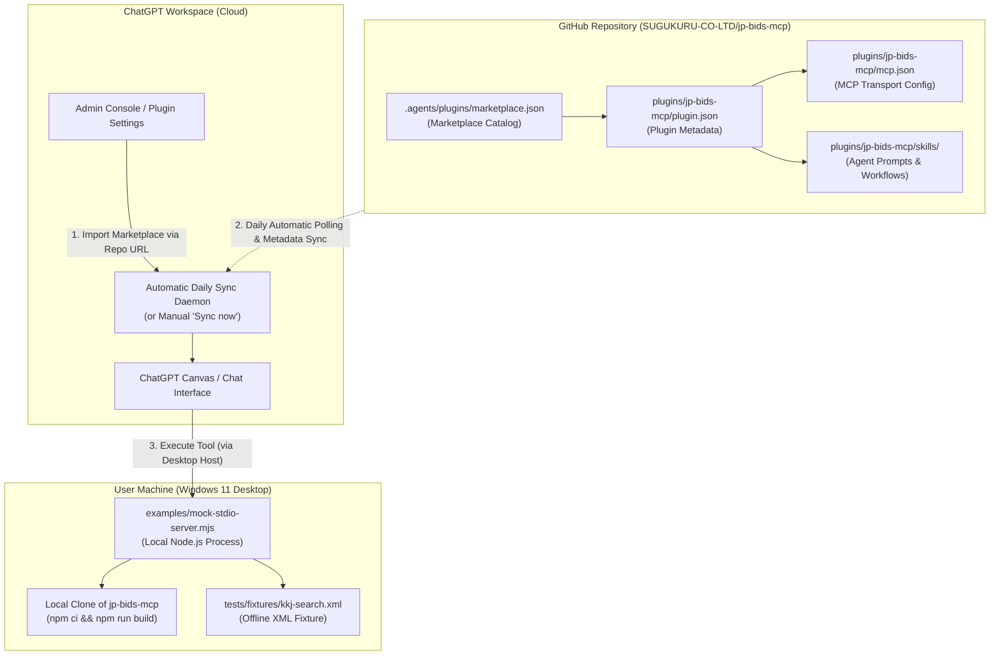

# JP Bids MCP — GitHub Marketplace による ChatGPT 統合ガイド

本ドキュメントは、OpenAI 公式の「GitHub プラグインマーケットプレイス連携」機能を利用し、ChatGPT ワークスペースに対して JP Bids MCP を自動同期・一元管理するための導入・運用手順書です。

---

## 1. 概要とアーキテクチャ (Overview & Architecture)

従来の手動によるクライアント設定（ローカル設定ファイルの個別編集）に代わり、**GitHub リポジトリ（`SUGUKURU-CO-LTD/jp-bids-mcp`）をマーケットプレイスソースとして ChatGPT ワークスペースにインポート** することで、組織全体へのプラグイン配布と日次の自動同期を実現します。



---

## 2. 重要な技術的境界と誤認防止事項 (Critical Scope & Boundary Notice)

> [!CAUTION]
> **GitHub 自動同期の対象範囲について**
> 
> 1. **GitHub 同期が自動化すること**:
>    - プラグインのカタログメタデータ（名前、バージョン、説明文、アイコン）の更新
>    - Agent Skills（プロンプト手順、システム指示、ツール選択ロジック）の最新版取得
>    - サーバー接続設定（`mcp.json`）の構成更新
> 
> 2. **GitHub 同期では自動化されないこと（手動実行が必要な事項）**:
>    - **ユーザーローカルマシンでの Node.js / ランタイムのインストール**
>    - **リポジトリのローカルクローン、依存解決（`npm ci`）、ビルド（`npm run build`）**
>    - **ローカルサーバープロセスの起動・終了・再起動**
> 
> 3. **「デスクトップ専用ローカル STDIO 方式」と「将来のクラウド HTTPS 方式」の明確な区別**:
>    - **現在の方式（デスクトップ専用ローカル STDIO モック）**:
>      ChatGPT デスクトップアプリが稼働する同一マシン上に本リポジトリが存在し、ビルド済みの `examples/mock-stdio-server.mjs` を子プロセスとして起動します。完全無料・実 API 通信なしで安全に動作しますが、マシンローカルでのビルドが必要です。
>    - **将来の方式（クラウド常時稼働 HTTPS 方式）**:
>      安定した公開 HTTPS エンドポイント（Streamable HTTP / SSE）をホスティングする構成です。ユーザーマシンでのローカルビルドは不要になりますが、インフラ構築・SSL 証明書・認証（OAuth）および公開審査が必要です（現在準備中）。

---

## 3. 前提条件と必要な管理者権限 (Prerequisites)

1. **ChatGPT アカウント / ワークスペース種別**:
   - ChatGPT Business、Team、または Enterprise アカウント。
2. **必要な管理者権限**:
   - ワークスペース管理者（Workspace Admin）権限。
   - ワークスペースのプラグイン管理画面（Admin Console → Plugins）へのアクセス権。
3. **ローカル環境の準備（デスクトップ専用ローカル STDIO 方式の場合）**:
   - Windows 11 / macOS / Linux 開発環境
   - Node.js 20+（v24.x 推奨）および npm
   - 本リポジトリのクローンとビルド完了（`npm ci && npm run build`）

---

## 4. ChatGPT でのインポート手順 (Step-by-Step Setup Guide)

### ステップ 1：管理コンソールからインポートを開始
1. ChatGPT に管理者アカウントでログインします。
2. 左下のワークスペース名をクリックし、**「Admin Console」**（管理コンソール）を開きます。
3. ナビゲーションメニューから **「Plugins」**（プラグイン）を選択します。
4. 画面右上の **「Add」**（追加）ボタンをクリックし、ドロップダウンから **「Import marketplace」**（マーケットプレイスをインポート）を選択します。

### ステップ 2：リポジトリ情報の登録
モーダル画面が表示されたら、以下の情報を入力します：

- **Source (リポジトリ URL)**:
  ```text
  https://github.com/SUGUKURU-CO-LTD/jp-bids-mcp
  ```
  *(※ブランチやサブフォルダの接尾辞は含めず、ベースのリポジトリ URL のみを指定します)*
- **Path (カタログパス)**:
  空欄（デフォルト）のままで問題ありません。カタログはリポジトリ内の標準パス `.agents/plugins/marketplace.json` に配置されています。
- **Branch, tag, or commit (対象ブランチ)**:
  空欄（デフォルトブランチの `main` を追跡）にします。

### ステップ 3：GitHub 認証とインポート完了
1. 画面の指示に従い、GitHub へのアクセス認可（GitHub OAuth）を承認します。
2. インポートが成功すると、ワークスペースのプラグイン一覧に **「SUGUKURU Public Procurement & Bids Marketplace」** が登録され、傘下の **「JP Bids MCP」** が利用可能になります。

---

## 5. 同期と更新の運用方法 (Synchronization & Updates)

### 自動日次同期 (Automatic Daily Sync)
OpenAI のマーケットプレイス連携機能により、リンクされた GitHub リポジトリ（`main` ブランチ）は **24時間ごとに自動ポーリング** されます。  
リポジトリ側で新しいプロンプト（Agent Skill）やプラグイン設定が push されると、翌日の同期サイクルで ChatGPT ワークスペース全体に自動適用されます。

### 即時手動同期 (Manual "Sync now")
緊急の修正やテスト時など、日次同期を待たずに最新のコミットを即時反映させたい場合：
1. **「Admin Console」→「Plugins」** を開きます。
2. 登録済みの `SUGUKURU Public Procurement & Bids Marketplace` の横にあるメニュー（`...`）をクリックします。
3. **「Sync now」**（今すぐ同期）を選択すると、数秒以内に GitHub から最新のマニフェストがフェッチされます。

---

## 6. ローカル STDIO 起動時の注意点とトラブルシューティング

- **Node.js 実行環境の確保**:
  ChatGPT デスクトップアプリが `mcp.json` の `command: "node"` を実行するため、OS のシステム PATH に `node` が含まれている必要があります。
- **初回ビルドの必須性**:
  リポジトリを新規クローンした直後は、`dist/` 配下のファイル（サーバー実行コードおよび `dist/apps/search-results.html`）が存在しないためエラーとなります。必ず事前に `npm ci && npm run build` を実行してください。
- **絶対パスの禁止方針**:
  公開リポジトリの `mcp.json` には、特定個人のホームディレクトリ（`C:\Users\USER\...`）などの絶対パスは一切記述されていません。常にリポジトリ相対パス（`examples/mock-stdio-server.mjs`）で記述されています。
