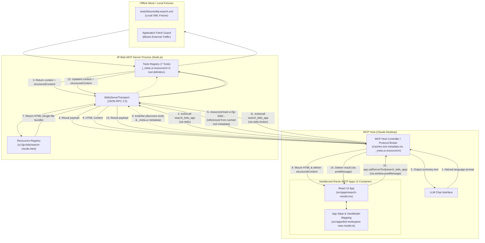

# JP Bids MCP — Public Technical Showcase: MCP Apps Interactive Demonstration

English technical overview is available below the Japanese section.  
本ドキュメントは、公式 MCP SDK および MCP Apps 拡張仕様を採用した官公需入札検索 MCP サーバー（JP Bids MCP）が、Claude Desktop 内でインタラクティブな対話型 GUI ワークスペースとして動作することを実証した技術 Showcase です。

---

## 1. 概要 (Executive Summary)

### 日本語
JP Bids MCP（公開リポジトリ: `SUGUKURU-CO-LTD/jp-bids-mcp`）は、経済産業省中小企業庁の官公需情報ポータルサイト（KKJ）の入札公告情報を検索・分析・活用するための Model Context Protocol (MCP) サーバーです。

本プロジェクトでは、従来の「テキストや JSON を返すだけの MCP ツール」にとどまらず、MCP Apps 拡張仕様（`@modelcontextprotocol/ext-apps`）を実装することで、LLM クライアント（Claude Desktop）内に **対話型 HTML ワークスペース（AI Bid Workspace）を直接描画・操作できるアーキテクチャ** を実現しました。

本ドキュメントでは、開発者が自身の環境でローカルモックを用いた動作確認を行えるよう、自己検証結果に基づく**実機スクリーンショット**、**アーキテクチャ解説**、**ソースコード照合**、および **客観的検証結果** を公開します。なお、外部の独立した第三者による再現性検証は現時点で未実施です。

### English Summary
JP Bids MCP demonstrates an advanced implementation of the **Model Context Protocol (MCP) and MCP Apps extension specification** (`@modelcontextprotocol/ext-apps`). It enables Claude Desktop to render and interact with a self-contained, interactive HTML/React workspace directly within the chat interface.

Rather than only returning flat text or JSON arrays, the server registers both structured tools and UI resources (`text/html;profile=mcp-app`), allowing bidirectional tool execution between the embedded GUI and the MCP server via the host application. This showcase provides self-verified real-device screenshots, architectural breakdowns, offline mock reproduction procedures, and test evidence. Note that independent third-party verification has not yet been conducted.

---

## 2. 実機デモ Showcase (Verified Interactive Demonstration)

以下の画面は、Windows 11 上の Claude Desktop において、ローカルモックサーバー（`examples/mock-stdio-server.mjs`）を接続して実際に操作・検証されたものです。

> [!NOTE]
> **実機キャプチャの取り扱いについて**
> - すべてのスクリーンショットは未加工（個人情報保護のための枠取り・トリミングのみ、描画内容の改変なし）の実際の実機画面です。
> - 表示されているデータは、`tests/fixtures/kkj-search.xml` によるローカルモックデータ（`KKJ-TEST-001`）であり、実 KKJ API との外部通信は行われていません。

---

### Step 1 (M1 & M2): チャット指示からのインライン Workspace 描画

LLM チャットに対して自然言語で入札検索を指示すると、Claude が `search_bids_app` ツールを選択・実行します。サーバーは構造化サマリーテキストを返すと同時に、メタデータで指定された UI リソース（`ui://jp-bids/search-results.html`）を Claude が読み込み、チャットの応答上部に **AI Bid Workspace** がインライン描画されます。


| 項目 | 内容 |
| :--- | :--- |
| **撮影日時** | 2026年10月12日 17:58:55 JST |
| **検証項目** | **M1**（MCP 経由の入札検索） / **M2**（MCP Apps ワークスペース描画） |
| **確認できる動作** | ① チャット上での `jp-bids-mock search_bids_app` ツール呼び出し<br>② チャットヘッダー直下に「AI Bid Workspace」ヘッダーと検索窓が表示<br>③ モック案件 `KKJ-TEST-001`（鹿児島市システム保守業務委託）の初期表示<br>④ チャット本文にテキストサマリーとテーブルが出力 |

---

### Step 2 (M3-A): UI 内でのインタラクティブな状態管理（選択・集計・活性化）

描画されたワークスペースは単なる静的 HTML プレビューではなく、独立した React アプリケーションとして動作しています。ユーザーがカード左のチェックボックスをクリックすると、ワークスペース内の状態が即座に更新されます。


| 項目 | 内容 |
| :--- | :--- |
| **撮影日時** | 2026年10月12日 18:01:37 JST |
| **検証項目** | **M3-A**（案件選択・件数更新・操作ボタン活性化） |
| **確認できる動作** | ① 案件カード左のチェックボックスがアクティブ化（青インジケータ点灯）<br>② 選択件数が「0件選択中」から **「1件選択中」** に即時更新<br>③ 「選択全解除」ボタンが出現し、一括操作アクションが有効化 |

---

### Step 3 (M3-B): UI 内からの双方向ツール呼び出し（再検索・結果更新）

ワークスペースを拡大表示し、ヘッダーの検索入力欄にキーワード **「保守」** を入力して [検索] ボタンを押下します。UI 内部から MCP プロトコル経由でホストを通じてサーバーの `search_bids_app` が呼び出され、返却された結果が画面内リストおよび詳細パネルへ反映されます。

#### 画面内キーワード入力


#### 検索実行と結果描画


| 項目 | 内容 |
| :--- | :--- |
| **撮影日時** | 2026年10月12日 18:02:10 JST（入力） / 18:05:28 JST（結果反映） |
| **検証項目** | **M3-B**（画面内検索操作・結果表示） |
| **確認できる動作** | ① ワークスペースのモーダル拡大表示<br>② キーワード欄「保守」の入力と [検索] ボタンのトリガー<br>③ サーバーからの結果を受け取り、案件一覧および右側詳細パネル（提出期限 2026-05-15、開札 2026-05-20、公告日 2026-04-25）が描画<br>④ 下部アクションボタン（「要件抽出」「詳細取得」「公式」「選択比較」等）が利用可能な状態でレンダリング |

> [!NOTE]
> M3-B の GUI 操作および検索結果の画面描画は実機操作にて確認済みです。なお、本検証では UI の視覚的成立を主目的としたため、バックエンド通信ログ（JSON-RPC メッセージ）との厳密なミリ秒単位の時系列突合検証はスコープ外としています。

---

## 3. アーキテクチャ解説 (Technical Deep Dive)

JP Bids MCP は、公式仕様に忠実な設計と厳格な責任境界を採用しています。

### システム構成図

MCP Apps 仕様では、UI（sandboxed iframe）はサーバープロセスと直接ソケット通信を行うのではなく、**MCP Host（Claude Desktop）を仲介した `window.postMessage`** によって安全にメッセージを交換します。

また、UI バインディング情報である `_meta.ui.resourceUri` はツールの登録時メタデータ（定義情報）であり、Host は初期化時の `tools/list` 等によって事前に発見・キャッシュします。実際のツール実行（`tools/call search_bids_app`）における返却値は `content`（要約テキスト）と `structuredContent`（構造化検索結果）です。

検索結果データを受け取った後のワークスペース状態管理およびビューモデル変換（`App State & ViewModel Mapping`）は、サーバープロセスではなく **React UI（`src/apps/search-results.tsx` / `bid-workspace-view-model.ts`）側のクライアント責務** として実行されます。



---

### 3.1. MCP SDK によるツール登録と公開 7 ツール

JP Bids MCP の公開 MVP プロファイルでは、`@modelcontextprotocol/sdk`（v1.32.1）の `McpServer` クラスを利用してツールを登録しています。

- **`search_bids`**: 条件（キーワード、都道府県、省庁、業務区分、日付範囲）に基づく入札公告情報検索
- **`list_recent_bids`**: 新着・締切間近の入札案件クイック取得
- **`get_bid_detail`**: 特定案件の詳細情報取得
- **`rank_bids`**: 自社プロファイルに基づく案件適合度スコアリング・評価
- **`extract_bid_requirements`**: 参加資格・提出要件・技術要件の抽出
- **`export_bid_shortlist`**: 追跡候補案件の CSV / JSON 出力
- **`search_bids_app`**: **MCP Apps 対応 UI ツール**（本 Showcase の中核）

ソースコード参照:
- [`src/tools/register-tools.ts`](../../src/tools/register-tools.ts)
- [`src/apps/register-search-app.ts`](../../src/apps/register-search-app.ts)

---

### 3.2. MCP Apps 拡張仕様の実装 (`@modelcontextprotocol/ext-apps`)

MCP Apps は、クライアント（Host）とサーバー間でセキュアに対話型 UI を共有するための仕様です。

#### 1. ツール定義と UI リソースの紐付け
`src/apps/register-search-app.ts` では、`registerAppTool` を使用して `_meta.ui.resourceUri` にリソース URI を宣言しています。

```typescript
// src/apps/register-search-app.ts（主要ロジックの抜粋）
const SEARCH_RESULTS_APP_URI = "ui://jp-bids/search-results.html";

registerAppTool(
  server,
  "search_bids_app",
  {
    title: "AI Bid Workspace",
    description: "日本全国の官公需入札情報を検索し、MCP Apps対応クライアントではAI Bid Workspaceとして検索結果を表示する。",
    inputSchema: searchBidsInputSchema,
    outputSchema: BidSearchResultSchema.shape,
    _meta: {
      ui: {
        resourceUri: SEARCH_RESULTS_APP_URI,
      },
    },
  },
  async (args) => {
    // 検索処理を行い、サマリーテキストと structuredContent を返却
  }
);
```

#### 2. リソース登録と CSP / パーミッションの責任境界
UI は `registerAppResource` により、MIME タイプ `text/html;profile=mcp-app` として提供されます。

```typescript
// src/apps/register-search-app.ts（主要ロジックの抜粋）
registerAppResource(
  server,
  "JP Bids Search Results App",
  SEARCH_RESULTS_APP_URI,
  {
    title: "JP Bids Search Results",
    _meta: {
      ui: {
        csp: {
          connectDomains: [],
          resourceDomains: [],
        },
        permissions: {
          clipboardWrite: {}, // CSV等のコピー用
        },
      },
    },
  },
  async () => ({
    contents: [
      {
        uri: SEARCH_RESULTS_APP_URI,
        mimeType: RESOURCE_MIME_TYPE, // "text/html;profile=mcp-app"
        text: await readSearchResultsAppHtml(),
      },
    ],
  })
);
```

> [!IMPORTANT]
> **CSP 宣言と多層防御の区別**
> - **UI リソースの CSP 許可設定**: `connectDomains: []` および `resourceDomains: []` は、埋め込み UI が通信または外部アセットを取得できる外部ドメインの許可リストです。空配列を指定することで、外部への接続や追加スクリプト・スタイルのロードを拒否するポリシーを Host に宣言しています。
> - **Host による CSP 適用**: このメタデータを解釈し、実際の iframe や WebView に Content Security Policy を適用して通信を制限するのは **MCP Host（Claude Desktop）側の責務** です。
> - **サーバー側の Fetch ガード**: Node.js サーバープロセス側で動作する `examples/mock-stdio-server.mjs` のガード（`globalThis.fetch` の例外送出）は、サーバープロセス自身が外部 KKJ API を誤って呼び出さないためのアプリケーションレベルのインターセプト処理です。
> - **境界の明確化**: これらはいずれもアプリケーションおよびプロトコル仕様に基づく制御であり、OS レベルのサンドボックスやネットワーク機器による完全な物理・パケット遮断を保証するものではありません。

---

### 3.3. フロントエンド設計: 単一 HTML バンドルと双方向通信

Claude Desktop のようなサンドボックス環境で動作させるため、フロントエンド（React 19）は以下の構成をとっています。

1. **Vite + `vite-plugin-singlefile`**:
   `vite.config.ts` により、すべての CSS、JS、画像アセットを `dist/apps/search-results.html` という 1 つのインライン HTML ファイルにコンパイルします。外部アセット読み込みの失敗や CORS 問題を原理的に排除しています。
2. **`@modelcontextprotocol/ext-apps/react` による双方向通信**:
   UI 側は `useApp` フックを通じてホスト環境と通信します。UI 内の [検索] ボタンが押された際、ブラウザの `fetch` ではなく、Host を仲介してサーバーの MCP ツールを実行します。

```typescript
// src/apps/search-results.tsx（実装の要点を簡略化した擬似コード / 抜粋）
import { useApp } from "@modelcontextprotocol/ext-apps/react";

function App() {
  const { app } = useApp();

  async function handleSearch(keyword: string) {
    // UI から Host を介してサーバーの MCP ツールを双方向呼び出し
    const result = await app.callServerTool({
      name: "search_bids_app",
      arguments: { query: keyword },
    });

    if (!result.isError) {
      applyResult(result.structuredContent);
    }
  }
}
```

---

### 3.4. オフラインモックと安全設計 (`examples/mock-stdio-server.mjs`)

外部開発者が実環境と同じ体験を安全に検証できるよう、リポジトリには専用のモック stdio サーバーが同梱されています。

- **ローカル XML フィクスチャ**: `tests/fixtures/kkj-search.xml` の静的データを読み込み、API レスポンスをエミュレート。
- **Application Fetch Guard**: サーバー内部で予期しない外部ネットワークアクセス（`globalThis.fetch`）が発生した場合に即座に例外を送出するガードを設置（※OS レベルのサンドボックスではありません）。
- **stdio 規約の厳格遵守**: JSON-RPC 2.0 通信が行われる `stdout` をクリーンに保つため、すべての診断・起動ログは `stderr` に出力。

---

## 4. 客観的検証結果 (Verification Matrix)

信頼性の高いオープンソース公開のため、各検証レイヤーの結果を厳格に区分して管理しています。

| レイヤー | 検証内容 | 結果 / ステータス | 根拠・エビデンス |
| :--- | :--- | :---: | :--- |
| **自動テスト** | 単体・結合・プロトコル検証 | **PASS** | Vitest 23 スイート / **182 テスト全件合格** |
| **型検査 & 静的解析** | TypeScript / Biome | **PASS** | `npm run check` エラー 0 件 |
| **ドキュメント整合** | TypeDoc API ドキュメント生成 | **PASS** | `npm run docs:check` 合格（型定義・APIリファレンス整合） |
| **GitHub Actions** | CI / CodeQL / Dependency Review | **PASS** | 全ワークフロー GREEN ([CI Run #38226024891](https://github.com/SUGUKURU-CO-LTD/jp-bids-mcp/actions)) |
| **セキュリティ監査** | 実行時依存パッケージ脆弱性 | **0件** | `npm audit --omit=dev` 検出 0 件 (MCP SDK 1.32.1 / Hono 4.13.13) |
| **クリーン環境検証** | 新規ディレクトリでのクローン・ビルド | **PASS** | `jp-bids-mcp-clean-verify` でのビルド (152ms) & stdio 疎通 |
| **Claude Desktop 実機** | M1〜M3-B の GUI 操作・UI 描画 | **PASS** | ユーザー実操作および本 Showcase 掲載スクリーンショット |
| **外部第三者独立検証** | 社外開発者によるブラインド検証 | **未実施** | 将来フェーズにて計画 |
| **実 API 受入試験** | 実 KKJ API への本番接続試験 | **未実施** | 公開リポジトリでは実 API 通信を遮断 |
| **本番デプロイ** | クラウド環境への一般公開ホスティング | **未実施** | ローカル開発・検証版として提供 |

---

## 5. 再現手順 (Quick Start for Developers)

外部の開発者が自身のローカル環境でこのデモを再現するための最短手順です。

### 1. クローンとビルド

```bash
# リポジトリのクローン
git clone https://github.com/SUGUKURU-CO-LTD/jp-bids-mcp.git
cd jp-bids-mcp

# 依存関係のインストール（再現性のため npm ci を推奨）
npm ci

# サーバーおよび MCP Apps UI のビルド
npm run build
```

> [!TIP]
> **Windows 環境における注意事項**
> - PowerShell の実行ポリシーにより `npm` コマンドがブロックされる場合は、`npm.cmd ci` および `npm.cmd run build` を使用してください。
> - ビルド完了後、`dist/apps/search-results.html` が生成されていることを確認してください。

---

### 2. Claude Desktop への登録

Claude Desktop の設定ファイル（`claude_desktop_config.json`）に、モック起動スクリプトの**絶対パス**を登録します。

```json
{
  "mcpServers": {
    "jp-bids-mock": {
      "command": "node",
      "args": [
        "C:\\path\\to\\jp-bids-mcp\\examples\\mock-stdio-server.mjs"
      ]
    }
  }
}
```

> [!IMPORTANT]
> **設定ファイルの保存場所**
> - **標準インストーラー版**: `%APPDATA%\Claude\claude_desktop_config.json`
> - **Microsoft Store (UWP) 版**: `%LOCALAPPDATA%\Packages\Claude_...\LocalCache\Roaming\Claude\claude_desktop_config.json` に仮想化リダイレクトされる場合があります。
> - 確実な起動のため、`command` には `node.exe` の絶対パスを指定することを推奨します。

---

### 3. Claude Desktop での動作確認

1. Claude Desktop を再起動します。
2. チャット入力欄で以下のように入力します：
   ```text
   鹿児島県の入札案件を検索して
   ```
3. Claude が `jp-bids-mock` の `search_bids_app` を実行し、チャット画面内に **AI Bid Workspace** が描画されます。
4. チェックボックスをクリックして選択件数の変化を確認したり、検索バーにキーワードを入力して画面内検索を体験してください。

---

## 6. 公開表現と免責事項 (Transparency & Disclaimer)

1. **実入札データとの関係**: 本 Showcase に掲載されているスクリーンショットおよびデモデータは、すべてオフライン XML フィクスチャ（`tests/fixtures/kkj-search.xml`）に基づく模擬データです。官公需情報ポータルサイトからリアルタイムに取得した最新の入札案件ではありません。
2. **公式認定に関する注記**: 本リポジトリはオープンソースの Model Context Protocol 仕様に基づいて独自に開発されたものであり、Anthropic 社または中小企業庁による公式認定、推薦、または提携を意味するものではありません。
3. **セキュリティ監査の範囲**: 実行時依存（production dependencies）についての `npm audit --omit=dev` は 0 件を確認していますが、開発時依存（dev dependencies）や将来の潜在的脆弱性を含めた完全無欠性を保証するものではありません。
4. **起動モードの区別**: `examples/mock-stdio-server.mjs` は完全にローカルで完結するモック環境ですが、`node dist/server.js` などの通常起動方式では環境変数によって実 KKJ API へのリクエストが実行される可能性があります。開発・検証目的では必ずモックスクリプトを使用してください。

---

## 7. 公式仕様および参照リンク (References)

- **Model Context Protocol (MCP) Official Specification**:  
  https://spec.modelcontextprotocol.io/specification/
- **MCP TypeScript SDK**:  
  https://github.com/modelcontextprotocol/typescript-sdk
- **MCP Apps Extension (`@modelcontextprotocol/ext-apps`)**:  
  https://github.com/modelcontextprotocol/ext-apps
- **中小企業庁 官公需情報ポータルサイト (KKJ)**:  
  http://www.kkj.go.jp/
